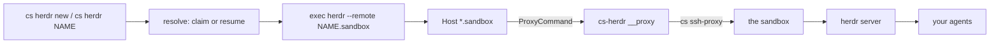

# cs-herdr

Run [Herdr](https://herdr.dev/) on Crafting sandboxes. `cs herdr new` makes one
and attaches; `cs herdr NAME` takes you back. Agents keep working after you
detach, close the laptop, or lose the network.

A `cs` CLI extension, spelled `cs herdr`. Works with any Crafting site.

## Herdr GUI and Core

The desktop app uses `hc` (Herdr Core), a separate server from the older
terminal `herdr`. The GUI does not import the old server's panes or agents.
Install Herdr GUI and Core from [herdr.dev](https://herdr.dev/), log in with
`cs login`, and connect an **existing** sandbox:

```bash
./bin/cs-herdr gui payments-fix/dev --org my-org --folder lab --install
# With the extension already on PATH:
cs herdr gui payments-fix/dev --org my-org --folder lab
```

`--install` permits `hc machine add` to install a compatible remote Core when
it is missing or incompatible. Omit it if Core is already installed. No worker
template, warm pool, `setup.sh`, or custom SSH config is required for this path.
Crafting's login-managed SSH configuration and `cs ssh` provide the transport.

The command validates the chosen workspace, resumes a suspended sandbox and
waits for readiness **before** registering it with Core. The readiness timeout
is 90 seconds; set `CS_HERDR_READY_TIMEOUT` to change it. A failed readiness wait
does not proceed with registration or installation. This avoids spending
Core 0.1.18's 20-second hello deadline on an initial sandbox wake.

The machine name defaults to `SANDBOX-WORKSPACE`; use `--name NAME` to override
it. Repeating the same command reuses its registration. After readiness, it
waits up to 60 seconds for Core to report the machine connected; set
`CS_HERDR_CONNECT_TIMEOUT` to change that limit. An existing registration still
backing off after a failed handshake cannot report success early. A connection
failure, required login or required update returns an error. `--no-open`
connects without opening the GUI. Machines are registered without `--temp` because
Herdr GUI 0.1.13 hides temporary machines. Select the machine when creating a
space in Herdr, or use its CLI:

```bash
herdr-app do space.new '{"name":"payments","machine":"payments-fix-dev"}'
hc exec --on payments-fix-dev uname -sm
hc machine ls
```

The stored transport includes the org, folder, sandbox and workspace explicitly,
so a later GUI launch does not depend on your shell's selected org. It calls
`cs ssh -T` with batch authentication and SSH keepalives, carries stdin/stdout
unchanged, and never retries underneath an existing SSH stream. Core owns
reconnects and checks the remote core's identity. Later automatic wakes still
have Core's per-attempt hello deadline: a slow wake can require several retries.
Run `cs herdr gui ...` again to perform the longer readiness wait explicitly.
Suspending a sandbox can end its processes; reconnect persistence is not a
promise that processes survive suspension.

Regression checks (mock transports, no remote changes):

```bash
python3 -m unittest discover -s tests -v
```

## Install

Needs `cs` logged in (`cs login`), `herdr` on this machine, `jq`, and a template
in your org. macOS and Linux.

```bash
git clone https://github.com/crafting-demo/cs-herdr && cd cs-herdr
./setup.sh
```

Asks which template to build from, starts a warm pool, and wires this machine.
`./setup.sh --example` creates a starter template if you have none.

Or paste this into an agent chat:

> Clone https://github.com/crafting-demo/cs-herdr and follow its SETUP.md to set
> up Herdr on Crafting sandboxes for me.

## Everyday use

```bash
cs herdr new                 # a new sandbox, then attach
cs herdr new payments-fix    # the same, named
cs herdr payments-fix        # back to that sandbox
cs herdr                     # back to the last one you used
```

`new` claims from the warm pool. `cs herdr NAME` resumes if Crafting suspended
the sandbox; it never creates — an unknown name is an error and a list.

Detach with `ctrl+b q`. The herdr server keeps running; `cs herdr NAME` returns
you to the same panes.

### What survives what

| | Agents keep running | Panes come back |
| --- | --- | --- |
| You detach, close the laptop, or lose the network | yes | yes |
| Crafting suspends the idle sandbox | no | yes |

A Crafting **suspend** freezes the container. The herdr server restarts on wake
and restores layout; processes inside panes are gone. Agent integrations
(`herdr integration install claude`) can restore their own sessions; anything
else you restart yourself. `cs herdr NAME` wakes a suspended sandbox.

Once attached, Herdr is ordinary Herdr. Extra spaces are `herdr` commands inside
the one sandbox, not extra sandboxes.

### The plain herdr command still works

Setup installs `Host *.sandbox` in `~/.ssh/config`, so any SSH client can reach
a sandbox by a short name and resume it on connect:

```bash
herdr --remote payments-fix.sandbox
herdr --remote db--payments-fix.sandbox   # a specific Crafting workspace
```

`cs herdr NAME` is that plus the resume-and-check. The alias also works for
`scp`, `git`, `rsync`, and editors.

## How it works



Three different "workspaces":

| Layer | What it is | Who owns it |
| --- | --- | --- |
| Crafting sandbox | the machine | `cs herdr new` / `cs herdr NAME` |
| Crafting workspace | a container in that sandbox | chosen at setup; `NAME/ws` to override |
| Herdr space | a pane group inside the herdr server | you and your agents, after attach |

One sandbox holds the whole herd. Herdr's sidebar is how you see them.

## Commands

| Command | What it does |
| --- | --- |
| `cs herdr new [NAME]` | create from the default template and attach |
| `cs herdr new --template T` | the same, from another template, this once |
| `cs herdr NAME[/WORKSPACE]` | resume if needed and attach; never creates |
| `cs herdr ls` | your sandboxes, their state, and their hostname |
| `cs herdr rm NAME [--delete]` | forget a name; optionally delete its sandbox |
| `cs herdr set-template NAME` | change what `new` builds from, from now on |
| `cs herdr status` | the resolved settings |
| `./doctor.sh` | check every requirement, with a named fix per failure |
| `./uninstall.sh` | unwire this machine and leave your sandboxes alone |

## Speed

Warm-pool claim: a few seconds. Cold build: a couple of minutes. Reconnect to a
running sandbox: about a second. Wake a suspended one: about twenty seconds;
`cs herdr NAME` waits for you.

The `*.sandbox` ProxyCommand retries a wake after a cached hostname fails.
Herdr itself does not retry, and would otherwise stop with `remote platform
detection failed`.

The worker template ships `herdr` already installed and running as a daemon,
because Herdr will not install itself through a non-interactive ProxyCommand.
See [examples/herdr-worker.yaml](examples/herdr-worker.yaml).

## Layout

| Path | Purpose |
| --- | --- |
| `SETUP.md` | the wizard prompt an agent follows to install it for you |
| `bin/cs-herdr` | the two verbs, and the ProxyCommand binder behind them |
| `lib/config.sh` | env -> conf -> cs discovery -> default resolution |
| `lib/sandbox.sh` | name -> sandbox resolution, claiming, resuming, locking |
| `setup.sh` | one command for the whole install |
| `bootstrap.sh` | the Crafting side: the warm pool on your template |
| `install.sh` / `uninstall.sh` | this machine's `~/.ssh/config` and PATH |
| `examples/herdr-worker.yaml` | an example template, created by `--example` |
| `doctor.sh` | health checks with a named fix per failure |

MIT licensed.
