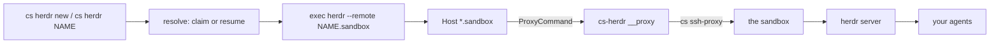

# cs-herdr

Run [Herdr](https://herdr.dev/) on Crafting sandboxes. Two commands: one makes a
new sandbox and sits you down at it, one takes you back to a sandbox you already
have. Agents keep working in the sandbox after you detach, close the laptop, or
lose the network.

Installs as a `cs` CLI extension, so it is spelled `cs herdr`. Works with any
Crafting site, self-hosted or not.

## Install

You need the `cs` CLI logged in (`cs login`), `herdr` on this machine, `jq`, and
a template in your Crafting org. macOS and Linux both work.

```bash
git clone https://github.com/crafting-demo/cs-herdr && cd cs-herdr
./setup.sh
```

It asks which template new sandboxes should be built from, saves the answer,
readies a warm pool, and wires up this machine. `./setup.sh --example` creates an
example template first if you have none.

Or paste this into an agent chat, which comes to the same question:

> Clone https://github.com/crafting-demo/cs-herdr and follow its SETUP.md to set
> up Herdr on Crafting sandboxes for me.

## Everyday use

```bash
cs herdr new                 # a new sandbox, then attach
cs herdr new payments-fix    # the same, named
cs herdr payments-fix        # back to that sandbox
cs herdr                     # back to the last one you used
```

`new` claims from the warm pool on the template you chose at setup and attaches.
`cs herdr NAME` resumes the sandbox if Crafting suspended it and attaches. It
never creates: a name it does not know is an error and a list, not a surprise
empty sandbox.

Detach with `ctrl+b q`. The herdr server keeps running inside the sandbox with
your agents in it, and `cs herdr NAME` brings you back to the same panes.

### What survives what

Two different things are easy to conflate, so plainly:

| | Agents keep running | Panes come back |
| --- | --- | --- |
| You detach, close the laptop, or lose the network | yes | yes |
| Crafting suspends the idle sandbox | no | yes |

Detaching costs you nothing: the sandbox is still running and so is everything
in it. You can be gone for hours and walk back into work that continued without
you.

A Crafting **suspend** is a stop, not a detach. The container is frozen, so the
herdr server restarts when the sandbox wakes. Herdr restores the workspaces,
tabs and panes it had, but the processes that were inside them are gone. Where
an agent integration is installed (`herdr integration install claude`), that
agent can pick its own session back up; anything else you restart yourself.

Crafting suspends sandboxes after a period of idleness, so this is the state a
sandbox you have not touched since yesterday will be in. `cs herdr NAME` wakes
it for you.

Once you are attached, Herdr is ordinary Herdr: spaces, panes, and the agents
you already run. `herdr` itself is how you (or an agent, through its CLI) open
more spaces -- those live inside the one sandbox and do not each need their own.

### The plain herdr command still works

Setup installs one `Host *.sandbox` block in `~/.ssh/config`, so any SSH client
can reach a sandbox by a short name, and the sandbox is resumed on connect:

```bash
herdr --remote payments-fix.sandbox
herdr --remote db--payments-fix.sandbox   # a specific Crafting workspace
```

`cs herdr NAME` is that command plus the resume-and-check, and is the one to
reach for. The alias exists so `scp`, `git`, `rsync` and editors can use the same
short name.

## How it works



Three things are all called some form of "workspace", and they are different:

| Layer | What it is | Who owns it |
| --- | --- | --- |
| Crafting sandbox | the machine | `cs herdr new` / `cs herdr NAME` |
| Crafting workspace | a container in that sandbox | chosen at setup; `NAME/ws` to override |
| Herdr space | a pane group inside the herdr server | you and your agents, after attach |

There is no router sandbox and nothing per-agent. Herdr is already the thing
that runs many agents on one machine, so one sandbox holds the whole herd, and
Herdr's own sidebar is how you see them.

## Commands

| Command | What it does |
| --- | --- |
| `cs herdr new [NAME]` | create from the default template and attach |
| `cs herdr new --template T` | the same, from another template, this once |
| `cs herdr NAME[/WORKSPACE]` | resume if needed and attach; never creates |
| `cs herdr ls` | your sandboxes, their state, and their hostname |
| `cs herdr rm NAME [--delete]` | forget a name; optionally delete its sandbox |
| `cs herdr set-template NAME` | change what `new` builds from, from now on |
| `cs herdr status` | the resolved settings |
| `./doctor.sh` | check every requirement, with a named fix per failure |
| `./uninstall.sh` | unwire this machine and leave your sandboxes alone |

## Speed

Claiming from a warm pool takes a few seconds; a cold build is a couple of
minutes. Reconnecting to a running sandbox costs about a second, because the
name-to-sandbox lookup is cached. Waking a suspended sandbox takes around twenty
seconds, and `cs herdr NAME` absorbs that wait for you.

The `*.sandbox` ProxyCommand handles the wake itself, including when it only
finds out the sandbox is asleep after the first connection fails. That matters
because Herdr does not retry: it would otherwise report `remote platform
detection failed` and stop.

Herdr installs itself onto an unknown remote host, interactively, and refuses to
in a non-interactive run -- which is what a ProxyCommand is. The worker template
therefore ships `herdr` already installed and already running as a daemon. See
[examples/herdr-worker.yaml](examples/herdr-worker.yaml).

## Layout

| Path | Purpose |
| --- | --- |
| `SETUP.md` | the wizard prompt an agent follows to install it for you |
| `bin/cs-herdr` | the two verbs, and the ProxyCommand binder behind them |
| `lib/config.sh` | env -> conf -> cs discovery -> default resolution |
| `lib/sandbox.sh` | name -> sandbox resolution, claiming, resuming, locking |
| `setup.sh` | one command for the whole install |
| `bootstrap.sh` | the Crafting side: the warm pool on your template |
| `install.sh` / `uninstall.sh` | this machine's `~/.ssh/config` and PATH |
| `examples/herdr-worker.yaml` | an example template, created by `--example` |
| `doctor.sh` | health checks with a named fix per failure |

MIT licensed.
